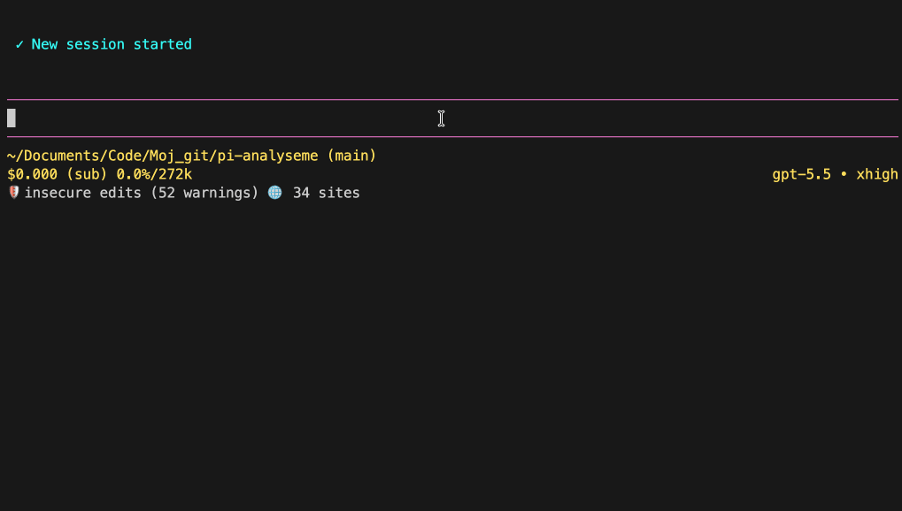

<p align="center">
  
</p>

<p align="center">
  <a href="https://pi.dev"></a>
  <a href="https://www.npmjs.com/package/@senad-d/analyseme"></a>
  <a href="LICENSE"></a>
</p>

# AnalyseMe

AnalyseMe is a [Pi](https://pi.dev) extension that lets you and your coding agent check an analyzed project's health and inspect findings in context.

<table align="center">
  <tr>
    <th>AnalyseMe demo</th>
  </tr>
  <tr>
    <td align="center">
      
    </td>
  </tr>
</table>

> **Security:** Pi packages run with your full system permissions. Use a trusted analysis service and keep your token out of chat and version control. See [Security](SECURITY.md).

## Table of Contents

- [Quick Start](#quick-start)
- [Inspect a project](#inspect-a-project)
- [If no results appear](#if-no-results-appear)
- [Application documentation](#application-documentation)
- [Installation](#installation)
- [Update and Uninstall](#update-and-uninstall)
- [License](#license)

---

## Quick Start

1. With Pi installed, install AnalyseMe:

   ```bash
   pi install npm:@senad-d/analyseme
   ```

2. From the repository you want to inspect, start Pi:

   ```bash
   pi
   ```

3. Enter `/analyseme help` in Pi to look up the exact setting names. Help works without credentials or network access. Enter `/analyseme` to see what is already configured locally.
4. Set the analysis service's HTTPS address, a token with read access, and a default project key if the repository doesn't supply one. Set the organization if your project requires it. Use a local `.env` in the repository, or export the settings and restart Pi from that shell. Nonempty shell settings take precedence over `.env`.
5. Open `/analyseme` again. **Ready** means the local configuration has the required settings and a default project key. It does not mean the service is reachable, the project exists remotely, or the token has access. The status view is read-only. Press `q` to close it.

---

## Inspect a project

Ask Pi for the project summary, then use a key from the list to open a specific finding. For example:

```text
Use AnalyseMe to summarize this project's quality gate and metrics, list the first 10 active issues, then open the first issue by its returned key. Show me the file, line, and any rule guidance available. Do not run a scan.
```

To inspect a security hotspot instead, ask Pi to list hotspots that need review, then open one by its hotspot key and show any available source context and security guidance. Hotspots are reviewed separately from active issues.

The read tools retrieve existing results; they don't analyze your current working tree. To inspect a specific branch or pull request, tell Pi which one to use for the summary, list, and detail. Use a branch **or** a pull request, not both.

You don't need a scanner to read results. Only ask Pi to run `analyseme_run_scan` when you intend to submit a new analysis. It runs a local scanner and sends the analysis to the configured service; the service may still be processing it after the scanner finishes.

---

## If no results appear

| What you see | What to try |
| --- | --- |
| **Needs setup** in `/analyseme` | Fix the missing or invalid settings shown in the status view. Use `/analyseme help` to check their names. |
| **Needs project** in `/analyseme` | Set a default project key, or give Pi the project key to use for the request. The key may differ from the repository name. |
| The service denies access | Check that your token can read the requested project. |
| The list returns no findings | Check the selected scope, warnings, and pagination. A page can be empty after filtering out issues that no longer need action or hotspots that no longer need review. |
| Results still show the previous analysis after a scan | Wait for the service to finish processing the submitted analysis, then ask Pi to read the summary again. |

---

## Application documentation

- [What AnalyseMe does](docs/PROJECT_DEFINITION_BRIEF.md) — what you can learn about a project and its findings.
- [Application specification](docs/APPLICATION_SPEC.md) — command behavior, tool inputs and outputs, and how to interpret results.
- [How AnalyseMe works](docs/STRUCTURE.md) — where data comes from and what happens on a read or a scan.

---

## Installation

| Scope | Command | Notes |
| --- | --- | --- |
| Global | `pi install npm:@senad-d/analyseme` | Loads in every trusted Pi project. |
| Project-local | `pi install npm:@senad-d/analyseme -l` | Writes to `.pi/settings.json` in the current project. |
| One run | `pi -e npm:@senad-d/analyseme` | Try without changing settings. |
| Git | `pi install git:github.com/senad-d/analyseme@<tag>` | Pin a tag or commit. |
| Local checkout | `pi --no-extensions -e .` | Develop or smoke-test this repository in isolation. |

Source checkout:

```bash
git clone https://github.com/senad-d/analyseme.git
cd analyseme
npm ci
npm run validate
pi --no-extensions -e .
```

---

## Development and Validation

```bash
npm ci
npm run typecheck
npm run lint
npm run format:check
npm run test
npm run check:pack
npm run validate
npm run smoke:pi
```

Isolated interactive smoke test:

```bash
PI_SKIP_VERSION_CHECK=1 PI_TELEMETRY=0 pi --no-extensions -e .
```

`npm run validate` includes type checking, linting, formatting checks, tests, package script checks, and package dry-run validation. CI runs the same validation chain.

Project docs:

- [`docs/STRUCTURE.md`](docs/STRUCTURE.md) — repository layout and boundaries.
- [`docs/VALIDATION.md`](docs/VALIDATION.md) — validation and smoke-test details.
- [`specs/spec-architecture.md`](specs/spec-architecture.md) — architecture plan.
- [`specs/spec-guidelines.md`](specs/spec-guidelines.md) — implementation guidelines.
- [`specs/spec-tasks.md`](specs/spec-tasks.md) — implementation task list.

---

## Update and Uninstall

```bash
pi update --extensions                       # update installed pi packages
pi update npm:@senad-d/analyseme          # update AnalyseMe only
pi remove npm:@senad-d/analyseme          # remove global install
pi remove npm:@senad-d/analyseme -l       # remove project-local install
```

---

## Publishing

AnalyseMe publishes to npm as `@senad-d/analyseme`.

```bash
npm login
npm whoami
node scripts/publish-npm.mjs
```

Run the publish script only from a clean working tree after updating `CHANGELOG.md`.

---

## License

MIT
